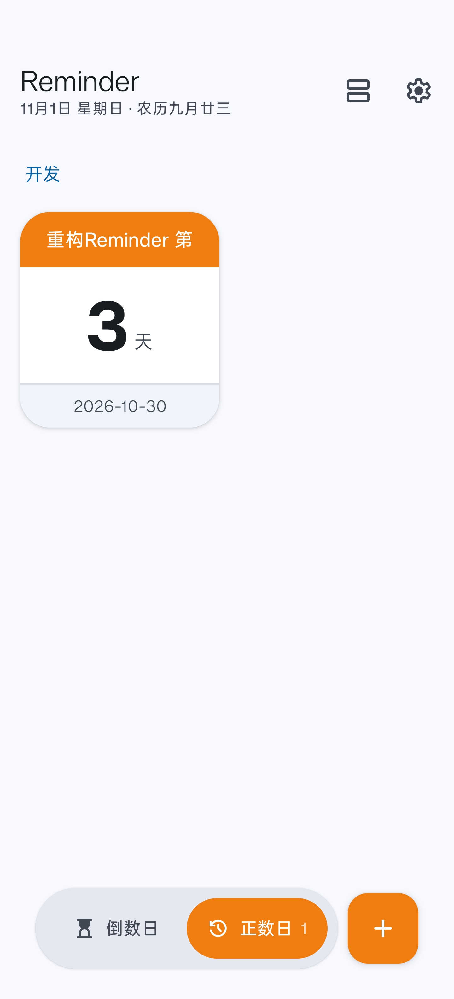
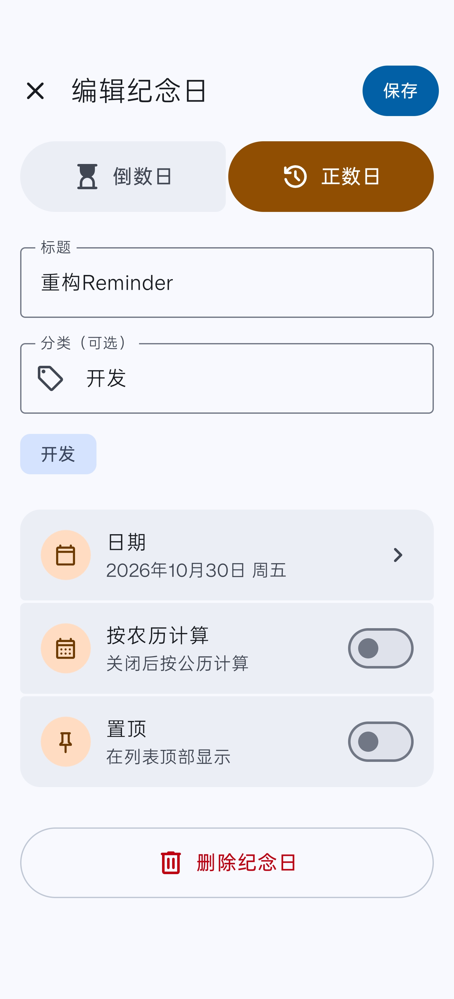
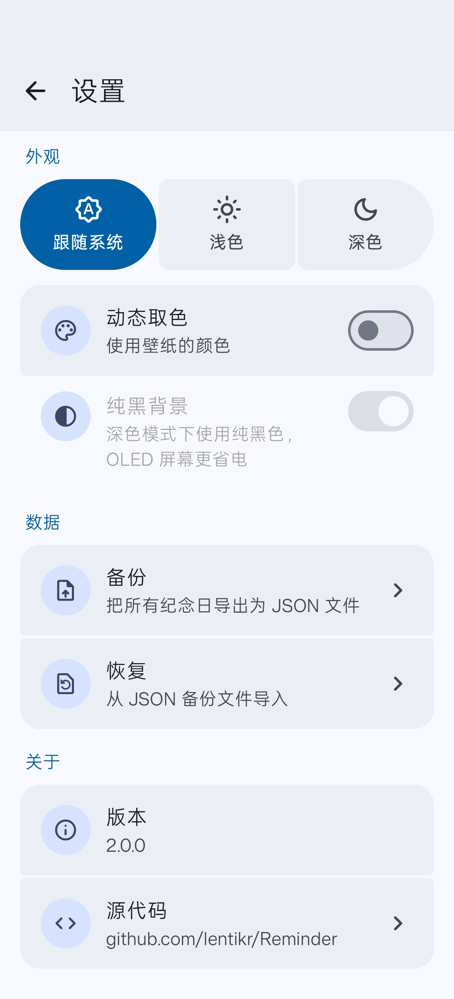
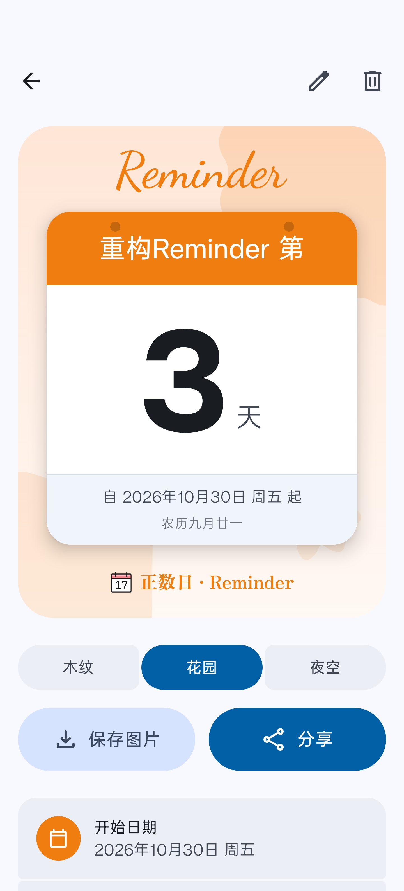

# Reminder

Reminder 是一款安卓纪念日应用，记录倒数日和正数日，支持农历、重复周期、分组置顶，并能把纪念日生成为图片分享。

<p align="center">
  
  
  
  
</p>

## 功能

- **倒数日与正数日**：倒数日显示“还有 N 天”，过期的一次性日期显示“已过”；正数日从开始当天算第 1 天。
- **农历**：可以直接用农历年/月/日滚轮选择日期，包括闰月。按农历重复时，闰月在没有该闰月的年份落到同名月份，三十在小月落到廿九。
- **重复周期**：每 N 天、周、月、年。下一次日期总是从原始日期推算，不会因为经过小月而漂移（例如 1 月 31 日按月重复，3 月仍是 31 日）。
- **分组与置顶**：置顶的纪念日排在最前，其余按分类分组；组内按最近的日期排序。
- **多选**：长按进入多选，可批量置顶或删除，删除后可在提示条中撤销。
- **分享与保存图片**：分享图沿用 1.x 的台历页样式，有木纹、花园、夜空三种背景，导出 1440×1920 的 PNG。保存到相册不需要存储权限。
- **外观**：跟随系统 / 浅色 / 深色；深色下可开纯黑背景；Android 12 以上可用壁纸动态取色；卡片和列表两种视图。
- **备份与恢复**：导出为带版本号的 JSON 文件，也能导入 1.x 导出的备份。
- **大屏**：平板和横屏下列表与详情并排显示。

## 技术选型

| 方面 | 选择 | 说明 |
| --- | --- | --- |
| UI | Jetpack Compose + Material 3 Expressive（`material3` 1.5.0-beta02） | ButtonGroup、FloatingToolbar、SegmentedListItem、形状变形和 expressive 动效都只在 1.5 系列里，所以单独固定了版本，领先 BOM |
| 导航 | Navigation 3 + `material3-adaptive` 的 `ListDetailSceneStrategy` | 返回栈由应用持有；同一套代码在手机上单栏、大屏上双栏 |
| 依赖注入 | Hilt，带参数的 ViewModel 用 assisted injection | |
| 存储 | Room 3 存纪念日，DataStore 存设置 | 数据库导出 schema，便于以后写迁移 |
| 农历 | [tyme4kt](https://github.com/6tail/tyme4kt) | 只在 `domain/LunarCalendar.kt` 里使用，其他代码不直接依赖它 |
| 序列化 | kotlinx.serialization | 备份文件和编辑草稿 |
| 文件 | 备份用存储访问框架（SAF），保存图片用 MediaStore，分享用 FileProvider | 全程不申请存储权限 |
| 系统集成 | Edge-to-edge、预测性返回、SplashScreen API | 启动页等设置读取完成才消失，避免主题闪烁 |

最低支持 Android 10（API 29），目标 API 37。

## 构建

需要 JDK 17 和 Android SDK 37。

```bash
./gradlew assembleDebug        # 调试版
./gradlew testDebugUnitTest    # 单元测试
./gradlew assembleRelease      # 发布版（开启 R8 压缩和资源压缩）
```

包名是 `app.lentikr.reminder`，调试版会加 `.debug` 后缀，两者可以装在同一台设备上。每种构建都输出两个 APK，位于 `app/build/outputs/apk/<debug|release>/`：

- `app-arm64-v8a-*.apk`：只含 arm64 原生库，适用于现在绝大多数手机
- `app-universal-*.apk`：包含全部架构，适用于模拟器、x86 设备和旧的 32 位手机

发布签名从项目根目录的 `keystore.properties` 读取，CI 上也可以用环境变量。这个文件和 `release.jks` 都已加入 `.gitignore`，不要提交。请另外备份 `release.jks` 和密码：丢失后无法再发布能覆盖安装的更新。

```properties
storeFile=release.jks
storePassword=…
keyAlias=…
keyPassword=…
```

对应的环境变量是 `REMINDER_STORE_FILE`、`REMINDER_STORE_PASSWORD`、`REMINDER_KEY_ALIAS`、`REMINDER_KEY_PASSWORD`。没有配置签名时，`assembleRelease` 输出未签名的 APK。

## 自动构建与发布

- `.github/workflows/ci.yml`：推送到 `main` 和每个 Pull Request 都会跑单元测试、lint 和调试版构建。
- `.github/workflows/release.yml`：推送 `v*` 标签时构建签名的发布版，创建 GitHub Release 并附上两个 APK 和 `SHA256SUMS`。标签必须和 `app/build.gradle.kts` 里的 `versionName` 一致，带 `-` 的标签（如 `v2.1.0-beta1`）会标成预发布。

发布工作流需要在仓库的 Settings → Secrets and variables → Actions 里配置四个 secret：

| Secret | 内容 |
| --- | --- |
| `REMINDER_KEYSTORE_BASE64` | `release.jks` 的 base64 编码 |
| `REMINDER_STORE_PASSWORD` | keystore 密码 |
| `REMINDER_KEY_ALIAS` | 密钥别名 |
| `REMINDER_KEY_PASSWORD` | 密钥密码 |

发布新版本时，先在 `app/build.gradle.kts` 里增加 `versionCode`、修改 `versionName`，提交后打标签：

```bash
git tag v2.0.1
git push origin v2.0.1
```

## 测试

单元测试覆盖最容易出错的逻辑：

- `DayCounterTest`：天数计算、各种重复周期、月末与闰日、农历重复中的三十和闰月
- `LunarCalendarTest`：已知节日的公农历换算、全年往返换算、闰月和月份天数
- `BackupCodecTest`：备份往返、未知字段、新版本文件、损坏文件、1.x 格式导入
- `BuildSectionsTest`：置顶、分类分组和排序
- `CaptionTest`：卡片和列表下方的日期说明，包括农历、闰月和跨年的腊月
- `ReadAtMostTest`：恢复备份时的文件大小上限

## 项目结构

```
app/src/main/kotlin/com/lentikr/reminder/
├── domain/      纪念日模型、天数计算、农历封装（纯 Kotlin，可单测）
├── data/        Room、DataStore、备份、图片导出
├── di/          Hilt 模块
└── ui/
    ├── home/        列表、卡片、多选
    ├── detail/      详情、分享图
    ├── edit/        新建/编辑、日期和重复选择器
    ├── settings/    设置
    ├── navigation/  Navigation 3 路由
    ├── common/      台历卡片等共用组件
    └── theme/       配色、动态取色、纯黑主题
```
